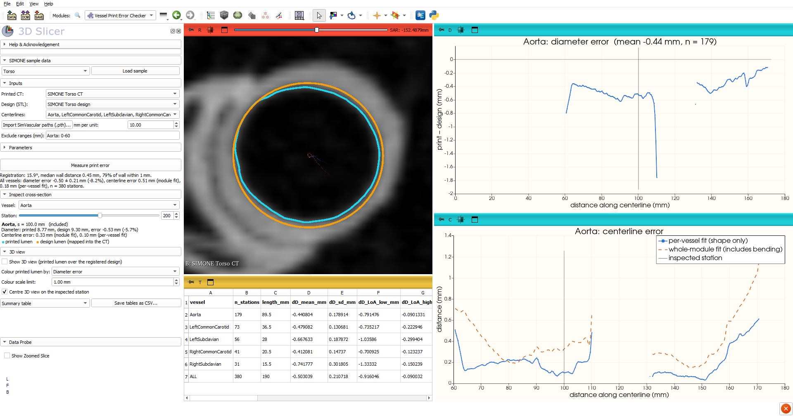

# Vessel Print Error Checker

This is a 3D Slicer module that measures how closely a 3D-printed vessel model matches its design. You give it:
- a CT scan of the printed model;
- the original lumen surface (STL);
- a centerline for each branch.

A **vessel** here is one connected vessel tree (one CT and one design STL), for example the SIMONE Torso: the aorta plus its four branches. A **branch** is one centerline within it.

It reports two errors along every branch, plus a summary for the whole vessel:
- **Diameter error:** printed minus design lumen diameter, as the equivalent diameter 2√(A/π).
- **Centerline error:** the distance between the printed and design centerlines after the print is registered to the design once, as a single rigid body. For elastic prints this includes how the soft vessel lay in the scanner.

It was written to validate the SIMONE simulator's printed vessel modules. Their scans and designs are included, so you can run it straight away.



---

## Install (about 5 minutes, once)

You need 3D Slicer and a copy of this repository. There is nothing else to install: no Python packages, no Slicer extensions, and no build step.

### Step 1: Install 3D Slicer
Download and install **3D Slicer 5.x** from <https://download.slicer.org>. It was tested on 5.12.4; any recent stable release should work.

### Step 2: Download this repository
Pick **one** of these:
- **Without git:** on <https://github.com/chrystalight/VesselPrintErrorChecker>, click the green **Code** button, then **Download ZIP**. Unzip it somewhere permanent, for example `Documents\VesselPrintErrorChecker`, not your Downloads folder, because Slicer will load the module from there every time it starts.
- **With git:**
  ```
  git clone https://github.com/chrystalight/VesselPrintErrorChecker.git
  ```

The download is about 700 MB, almost all of it the SIMONE sample CT scans.

You should now have this structure:
```
VesselPrintErrorChecker\                     <- repository folder
├── VesselPrintErrorChecker\                 <- THE MODULE FOLDER (you'll point Slicer here)
│   ├── VesselPrintErrorChecker.py
│   └── VesselPrintErrorCheckerLib\
├── SIMONE_validation_files\
├── scripts\
└── README.md
```

### Step 3: Tell Slicer where the module is
1. Open 3D Slicer.
2. Go to **Edit → Application Settings** (on macOS: **Slicer → Preferences**).
3. Click **Modules** in the list on the left.
4. Find the box **Additional module paths** and click **Add** next to it.
5. Browse to the **inner** `VesselPrintErrorChecker` folder, the one that contains `VesselPrintErrorChecker.py` (marked *THE MODULE FOLDER* above), and select it.
6. Click **OK**. When Slicer asks to restart, click **Yes**, or close and reopen Slicer yourself.

> **Shortcut:** instead of steps 2–6, drag `VesselPrintErrorChecker.py` from your file browser onto the Slicer window. Choose **Add Python scripted modules to the application**, tick the module, click **Yes** to add it to the module paths, then restart Slicer.

### Step 4: Check it worked
1. Click the **magnifying glass** next to the *Modules* drop-down on the toolbar (or press **Ctrl+F**).
2. Type `Vessel Print` and open **Vessel Print Error Checker**. It also appears under **Modules → Quantification**.
3. The left panel should show these sections: **SIMONE sample data**, **Inputs**, **Parameters**, **Measure print error** and **Inspect cross-section**.

### Troubleshooting
| Problem | Fix |
|---|---|
| The module isn't in the list | You probably added the outer repository folder. Remove it from *Additional module paths*, add the inner `VesselPrintErrorChecker` folder (the one with the `.py` file) and restart. |
| It's listed but shows an error | Open **View → Python Console** to see the message. The folder must contain `VesselPrintErrorCheckerLib\` next to the `.py` file; don't move the `.py` on its own. |
| The SIMONE sample list is empty | `SIMONE_validation_files` must sit next to the module folder, as in the repository. Keep the repository layout as it is. |
| You moved or renamed the folder | Update the path in *Additional module paths* and restart. |

### Updating
Run `git pull`, or download the ZIP again into the same place, then restart Slicer.

## Quick start with the SIMONE data
1. Open the module.
2. Under **SIMONE sample data**, pick *Torso*, *Cranial* or *Femoral* and click **Load sample**. This loads the CT, the design STL and the centerlines, and fills in the inputs.
3. Click **Measure print error**. It takes about 20–60 s.
4. Compare with `SIMONE_validation_files/expected_results/`.

## Using your own data
| Input | How to provide it |
|---|---|
| **Printed CT** | Load it with Slicer's DICOM browser (or any volume format). |
| **Design (STL)** | Drag the STL into Slicer. It must be the lumen surface (inner wall) of the design, in mm. |
| **Centerlines** | Either click **Import SimVascular paths (.pth)...** and pick your path files (set *mm per unit* to 10 if SimVascular worked in cm), or draw one open curve per branch with Markups → Curve. A curve only needs to run inside the printed lumen; it doesn't have to be centred. |

The centerlines must be drawn on the printed CT, not on the design. The design can be in any position or orientation, because the module registers it automatically.

Tick **Treat bright insert as lumen** under *Parameters* if something bright, such as an introducer sheath, sits inside a vessel. The insert then counts as part of the lumen: where it lies against the wall, its own outer surface is taken as the lumen edge. Stations where more than 60% of the wall is only seen through insert contact are excluded.

To leave out a stretch you know is unreliable, such as a section that held water during scanning, fill in **Exclude ranges (mm)**. Give distances along the centerline, for example `Aorta: 0-60; ICA: 5-12`; several ranges per vessel are separated by commas. Excluded stretches are left out of the results and also out of the registration. They show as `user excluded` in the per-station table. The SIMONE Torso sample fills this in for you (`Aorta: 0-60`, where water pooled in the lower aorta). To leave a whole branch out of the results, write `all` instead of a range, for example `LeftIliac: all; RightIliac: all`. That branch is still measured and still used to align the print with the design (a single straight vessel on its own cannot be aligned reliably), but none of its stations are reported; they show as `branch not reported`. The SIMONE Femoral sample fills this in for both iliacs, where the introducer sheaths are too bright for a reliable lumen edge.

## Outputs
- **Summary table** (each branch, plus `ALL` for the whole vessel) and **per-station table**. Switch between them with the drop-down, and export everything with **Export CSV...** (see *Exported files* below).
- **Diameter error plot** and **centerline error plot** for the branch you are inspecting. Pick another branch in *Inspect cross-section* to switch.
  - Both plots run along the branch's centerline, and each title gives the branch mean.
  - A grey vertical line marks the inspected station. Excluded stations are left as gaps.
  - Use the summary table to compare branches.
- **Inspect cross-section:** choose a branch and station, or click a point in either plot. The left view reslices the CT onto that cross-section and shows:
  - the printed lumen (cyan);
  - the design lumen mapped into the CT (orange);
  - that station's numbers.

  The view re-centres and zooms onto the contours every time you change station, even if you have panned or zoomed in the meantime.
- **Correcting a station by hand:** if an automatic contour is a bit off, tick **Edit printed contour** under *Inspect cross-section*. The cyan contour becomes a smooth curve with 16 points you can drag in the cross-section view. Click **Apply edited contour** to use it: that station's diameter, error and centre are recomputed, and the summary, plots and 3D view update. **Exclude / include station** leaves a station out, or brings back an excluded one that has both contours. Changed stations are marked `edited` in the per-station table. Edits are lost if you click *Measure print error* again, so save the CSVs first.
- **3D view:** tick **Show 3D view** under *3D view*. A 3D panel opens next to the cross-section. It shows the printed lumen as one continuous surface segmented from the CT, junctions included, over a translucent grey copy of the design registered into the CT.
  - **Colour printed lumen by:** choose *Diameter error* (blue = narrower than designed, red = wider), *Centerline error*, or *None*. A colour legend appears in the 3D view.
  - **Colour scale limit:** sets the end of the colour scale. Diameter error runs from −limit to +limit; centerline error runs from 0 to the limit.
  - **Centre 3D view on the inspected station:** keeps the 3D camera on the station you are inspecting, without changing your zoom or angle.
  - The surface is coloured from the nearest included station. Parts with nothing to compare against are grey. Fluid-filled stretches that were measured are drawn from their measured contours; stretches that could not be measured are missing from the surface.
  - The original design model is hidden in 3D because it sits in its own coordinate frame, away from the CT. The registered copy is called *VPE design (registered to CT)*.

### Exported files
**Export CSV...** asks for a folder and writes three files there. The command-line runner writes the same three, named after the sample (`Cranial_stations.csv`, ...).

| File | One row per | Use |
|---|---|---|
| `VPE_bland_altman.csv` | included station | ready for a Bland–Altman plot: x = `mean_D_mm`, y = `diff_mm` |
| `VPE_stations.csv` | station, included or not | everything measured, with the reason for each exclusion |
| `VPE_summary.csv` | branch, plus `ALL` | the numbers in the summary table |

**`VPE_bland_altman.csv`**

| Column | Meaning |
|---|---|
| `branch`, `station`, `s_mm` | which centerline, station number along it (from 0), and distance along it |
| `D_design_mm`, `D_print_mm` | equivalent lumen diameters of the design and the print |
| `mean_D_mm` | (print + design) / 2: the Bland–Altman x axis |
| `diff_mm` | print − design: the Bland–Altman y axis (same as `dD_mm`) |
| `diff_pct` | the difference as a percentage of the design diameter |
| `at_junction`, `fluid_filled`, `edited` | 1/0 flags, as in the per-station table, in case you want to mark or drop those points |

The bias is the mean of `diff_mm` and the limits of agreement are mean ± 1.96 SD; both are already in `VPE_summary.csv` (`dD_mean_mm`, `dD_LoA_low_mm`, `dD_LoA_high_mm`). Stations are 0.5 mm apart along a vessel, so neighbouring points are not independent; the limits of agreement describe the spread along the vessel, not a confidence interval.

**`VPE_summary.csv`**

| Column | Meaning |
|---|---|
| `branch` | centerline name, or `ALL` for every included station of the vessel |
| `n_stations`, `length_mm` | included stations, and the length they cover (stations × spacing) |
| `dD_mean_mm`, `dD_sd_mm` | mean and standard deviation of the diameter error (print − design) |
| `dD_LoA_low_mm`, `dD_LoA_high_mm` | Bland–Altman limits of agreement: mean ∓ 1.96 SD |
| `dD_mean_pct` | mean diameter error as a percentage of the design diameter |
| `cl_dev_mean_mm`, `cl_dev_p95_mm`, `cl_dev_max_mm` | centerline error: mean, 95th percentile and maximum |

**`VPE_stations.csv`**

| Column (per-station table) | Meaning |
|---|---|
| `station` | station number along the centerline, from 0 |
| `s_mm` | distance along the centerline |
| `D_print_mm`, `D_design_mm` | equivalent lumen diameters |
| `dD_mm`, `dD_pct` | diameter error, print − design |
| `branch` | which centerline the station belongs to |
| `cl_dev_mm` | centerline error: distance from the printed centre to the design centerline under the single rigid-body registration |
| `at_junction` | 1 if the station is at a junction and its diameter error comes from the wall offset (see Method) |
| `edited` | 1 if the station was changed by hand |
| `insert_hidden_frac` | fraction of the wall seen only where an insert touches it |
| `fluid_filled` | 1 if the lumen held fluid there and was measured from the fluid/wall edge (see Method) |
| `excluded` | empty if the station is included, otherwise the reason (see below) |
| `x, y, z` | printed centerline point (CT world coordinates) |

## Method
1. **Stations:** each centerline is resampled every 0.5 mm.
2. **Printed lumen:** the CT is resliced in a plane normal to the centerline. The wall is found on 90 rays (every 4°) at the **half-maximum** between the lumen level and the wall peak. A ray counts only if the wall is at least 250 HU above the lumen, and rays that disagree with their neighbours are dropped. Each ray is limited to the local lumen radius + 2.5 mm, so it cannot run into a neighbouring vessel.
3. **Re-centring:** each section is re-centred on its lumen centroid and the tangent is re-estimated; this is done 3 times. The printed centerline is therefore measured from the CT, not taken from where the curve was drawn. A centre may move at most 3 mm (or ¾ of the lumen radius, if larger) from the drawn curve, so it can never jump into a neighbouring vessel where two vessels pass close together.
4. **Registration:** the printed lumen is rigidly registered to the design with ICP. The search starts from 24 orientations × 9 positions. Each iteration only uses point pairs closer than a threshold that shrinks from 20 mm to 1.5 mm, which makes it robust to diameter bias and unmatched regions.
5. **Design sections:** each printed station is mapped into the design with that one registration, and the design is sectioned normal to its own centerline there (nearest lumen loop, re-centred over 3 passes).
6. **Errors:** diameter error is printed minus design equivalent diameter. Centerline error is the distance from the printed centre to the design centerline under the rigid-body registration.
7. **Wall-offset check:** each station's printed wall points are also compared with the design surface directly, fitting *signed distance = radius error + sideways shift · normal*. Twice the radius error is a second, independent estimate of the diameter error. Ordinary stations where the two estimates differ by more than 0.3 mm are excluded as `design mismatch` (they were matched to the wrong place in the design). On the SIMONE data the two agree to within 0.02 ± 0.04 mm.
8. **Junctions:** where a branch passes a side branch's opening, the cross-section is open, so an equivalent diameter is not defined. There the diameter error is taken as twice the radius error from the wall-offset fit, using the part of the wall that is present (at least 40% of it, with no gap over 200°), and the centerline error is the fitted shift. A branch's first or last stations that still lie inside its parent are not used; that wall is measured in the parent. A junction station is also skipped if its fitted shift differs by more than 0.5 mm from the centerline error of the neighbouring ordinary stations.
9. **Fluid-filled sections:** where the drawn centerline lies in fluid (for example water left in after flushing), there is no air in the lumen. Fluid and wall differ by only about 100 HU on these scans, against about 1100 HU between air and wall, so single-ray half-maxima are not usable. Instead:
   - profiles are averaged over ±1 mm along the vessel;
   - the outer wall edge (wall to outside air) is found on each ray;
   - all rays, aligned at that edge, give one low-noise profile. A blurred-wall model is fitted to it: fluid level, wall level, wall thickness and blur width;
   - with those levels fixed, each ray is fitted for its inner and outer edge. The wall thickness is smoothed around the circumference (median over 60°) and subtracted from the outer edge;
   - the edge is then moved to where the half-maximum would lie if the lumen held air (a shift of about 0.04 mm for a 1.2 mm wall), so fluid-filled and air-filled stations follow the same convention.

   A section is only measured this way if the wall is clear of other objects on at least 85% of rays, the wall is at least 60 HU brighter than the fluid, there is no air inside the contour, and the lumen radius is at least 3 blur widths (about 1 mm; smaller lumens never show the fluid's own level). These stations have `fluid_filled` = 1. Stations within 2 mm of a change between air and fluid are excluded as `next to fluid surface`. This mode is off when *Treat bright insert as lumen* is on.
10. **Exclusions:** each excluded station gets one of these reasons in the `excluded` column.

| Reason | Meaning |
|---|---|
| `open` | more than 15% of rays found no wall: an outlet, a junction, or a lumen with no visible contrast |
| `no lumen near path` | no lumen within 3 mm (or ¾ of the lumen radius) of the drawn centerline: the path runs through the wall, or the lumen holds fluid and could not be measured from the fluid/wall edge either (partly filled, too small, or touching another object). The centre is never allowed to jump into a neighbouring vessel. |
| `next to unmeasurable section` | within 2 mm of an `open` or `no lumen near path` stretch; these transition sections are often partly filled |
| `next to fluid surface` | within 2 mm of a change between air-filled and fluid-filled stations |
| `end` | within 2 mm of a centerline end |
| `junction` | a junction station that could not be measured from the wall offset (too little wall, or a poor fit), or a branch's first or last stations inside its parent |
| `shared with X` | this stretch runs along the same lumen as branch X (for example, two branch paths that both start in a common trunk). It is measured once, in the branch listed first (X), so the trunk isn't counted twice. |
| `insert contact` | more than 60% of the wall is only seen where an insert touches it |
| `no design section` | the design has no lumen there (the print extends past the design) |
| `design mismatch` | the two diameter-error estimates disagree by more than 0.3 mm, or the design centre is more than the *Mismatch limit* (8 mm) away |
| `design artefact` | the design section jumps away from its local trend, as at a capped outlet or a branch ostium |
| `below CT resolution` | the design diameter is under the *Min design diameter* setting (0 = off) |
| `user excluded` | inside a range given in *Exclude ranges (mm)* |
| `branch not reported` | the whole branch was given as `all` in *Exclude ranges (mm)*: used for the registration only |

All parameters are under *Parameters* in the module, with tooltips.

## Command line (no GUI)
`scripts/run_headless.py` runs the same engine with Slicer's Python and writes the CSV tables:
```
<Slicer>/bin/PythonSlicer scripts/run_headless.py                  # all SIMONE samples
<Slicer>/bin/PythonSlicer scripts/run_headless.py --ct DICOM_DIR --design design.stl --paths PTH_DIR --out results
```

## Repository layout
```
VesselPrintErrorChecker/            Slicer module (add this folder to Slicer's module paths)
  VesselPrintErrorChecker.py        user interface, tables, plots, inspect view
  VesselPrintErrorCheckerLib/core.py  measurement engine (numpy/scipy/vtk only; no Slicer dependency)
SIMONE_validation_files/            sample data (see its README)
scripts/run_headless.py             command-line runner
```

## Known limitations
- Lumens below about 2 mm (around 5 voxels at 0.4 mm) are measured narrow because of CT blur, so treat them as approximate.
- Sections with an insert are less precise (about ±0.3 mm on the SIMONE iliacs) because part of the wall is inferred from the insert's surface. The SIMONE Femoral sample therefore leaves both iliacs out of the results by default.
- Fluid left in a lumen during scanning: fully filled sections are measured from the fluid/wall edge (Method, step 9). That edge has about a tenth of the contrast of an air/wall edge, so single stations are noisier and lumens under about 2 mm cannot be measured this way. On the SIMONE Cranial module the fluid-filled stations read −0.39 ± 0.14 mm against −0.46 ± 0.13 mm for the air-filled ones. Partly filled sections read narrow, because the contour follows the air–fluid surface instead of the wall (in the inspect view the contour then has a flat side); exclude those with *Exclude ranges*.
- The half-maximum edge of a thin wall sits slightly inside the true edge. For the SIMONE Cranial walls (about 1.2 mm, blur width about 0.35 mm) a wall-model fit puts the lumen about 0.1 mm wider in diameter than the half-maximum does. All stations use the half-maximum convention, so this applies to every reported diameter error equally.
- Registration is least certain when the scanned vessels cover only part of the design, as with the SIMONE Cranial module. There the result can shift slightly (a few stations, ~0.03 mm) depending on centerline order.
